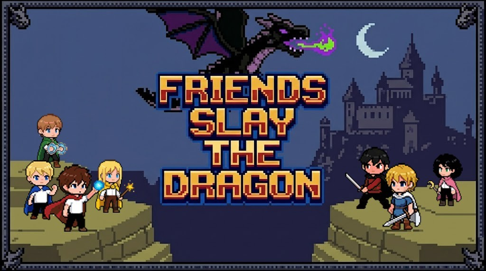

# Friends Slay the Dragon

A chaotic castle brawler where you charge through gothic halls as one of your friends, swallow terrifying monsters whole, and steal their powers to take down a dragon that absolutely has it coming.

---

## What even is this?

You're a little bored. The castle is enormous and full of zombies, skeletons, flying ducks, and a very dramatic boss dragon. You run. You jump. You **swallow enemies whole** and absorb their elemental powers — fire, lightning, ice — then unleash them on everything else in the room. Shield yourself from incoming fire. Break every piece of furniture you see.

Somewhere deep in the castle, past a gothic double-door with iron knockers and a foreboding glow, the dragon waits. He breathes fire. He shoots lightning bolts. He rains icicles. He is not having a good day, and neither will you — until you're not.

## How to play

Pick one of your friends and fight your way to the dragon. Use a keyboard, a touch screen, or a Bluetooth controller.

## Go play

**[Friends Slay the Dragon!](https://www.friendsslay.com)**

No download. No install. Just vibes and dragon-slaying.

---

*Sprites built with [Pixel Lab](https://www.pixellab.ai/) · Maps built with [Sprite Fusion](https://www.spritefusion.com/) · Music built with [Gemini](https://gemini.google.com/)*  
*Built with [Phaser 3](https://phaser.io/)*
